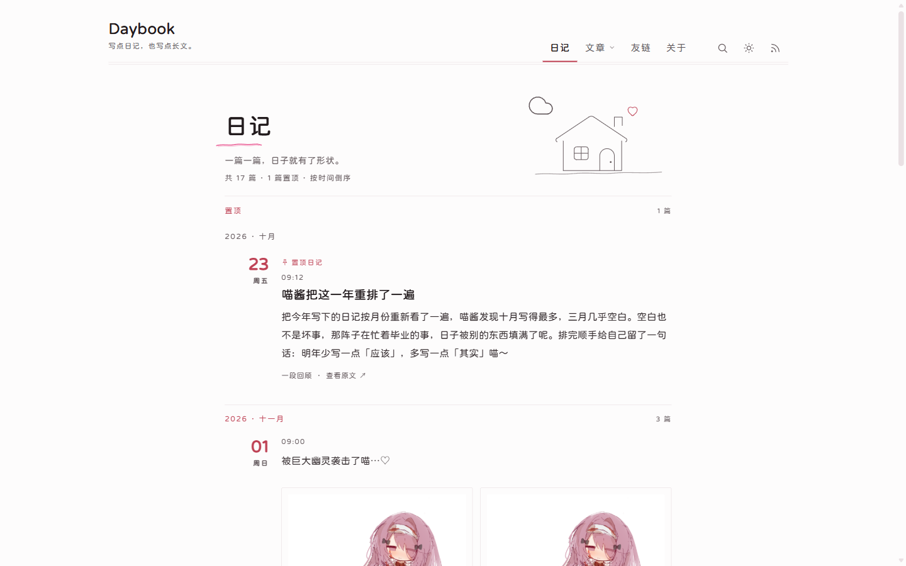
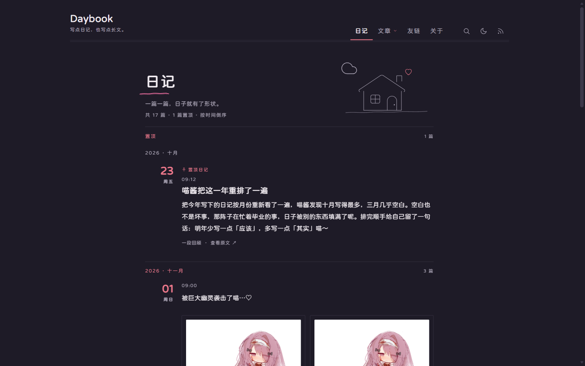
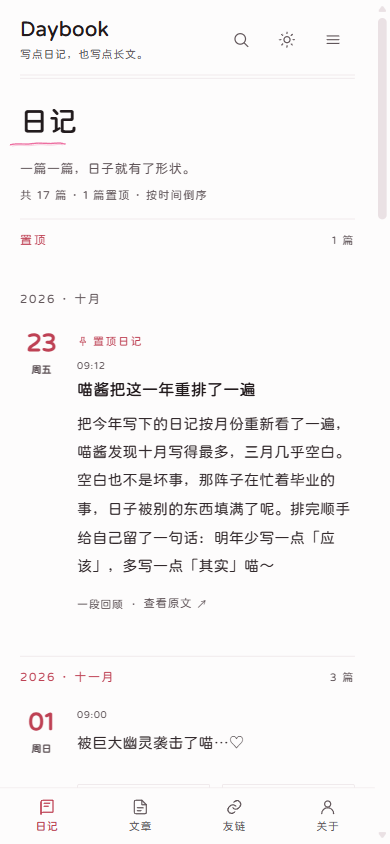
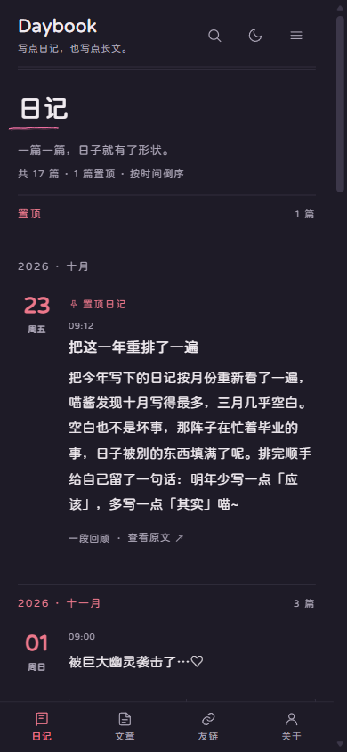
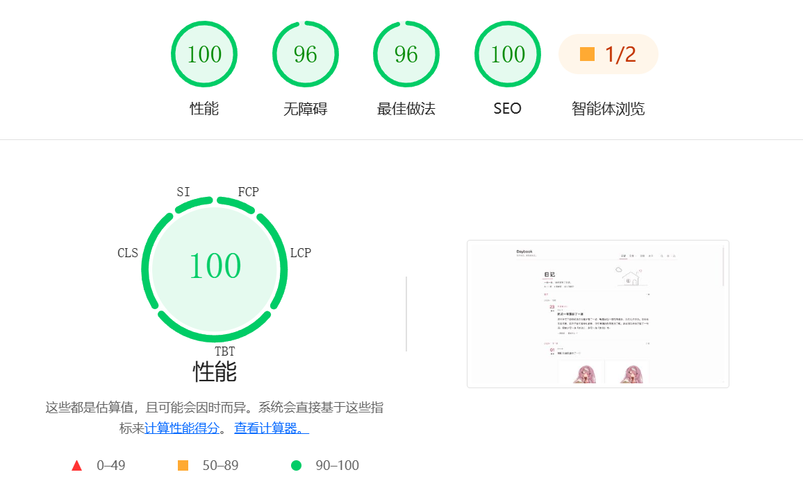

# Daybook

A diary site made for slow reading — a static blog theme built on Astro. Write each day down in Markdown, and build it into a quiet, understated personal blog you can search.

**Live demo**: <https://daybook.demo.ksable.top/>

[简体中文](./README.md) · English · [日本語](./README.ja.md) · [繁體中文](./README.zh-TW.md)

---

<table width="100%" align="center">
  <tr>
    <td colspan="3" align="center">
      
      <br>Desktop · Light
    </td>
  </tr>
  <tr>
    <td align="center"><br>Desktop · Dark</td>
    <td align="center"><br>Mobile · Light</td>
    <td align="center"><br>Mobile · Dark</td>
  </tr>
  <tr>
    <td colspan="3" align="center">
      
      <br>Lighthouse
    </td>
  </tr>
</table>

---

## Features

- **Diaries first**: one entry a day, grouped by month automatically, with a date rail on the left that makes the timeline easy to scan
- **Articles kept apart**: when you need to write something long, put it in the articles folder — categories, tags and keywords come built in
- **A quiet design**: paper-white background, hairline dividers, soft pink accents — no cards, no outlines, no shadows
- **Dark mode**: follows the system, or switch it by hand; no white flash when toggling
- **Full-text search**: the index is built at build time, results appear as you type, and you can filter by Diaries, Articles and Pages
- **Pinned and drafts**: pinned diaries get a group of their own; drafts only show up while developing locally
- **Long entries fold away**: the home feed shows just the opening — hit “Read more” when you want the rest
- **Richer reading**: a table of contents in the margin, syntax highlighting, math formulas, click-to-zoom images, footnotes
- **Password protection**: keep a single entry to yourself with one password
- **Comments**: hook up Twikoo, Waline or Artalk whenever you like
- **Archive and heatmap**: look back over everything by year and month; the writing heatmap shows which days left words behind
- **Feeds and sharing**: three RSS feeds, a sitemap, robots, plus link preview images
- **Music page**: play a playlist you love right inside the site
- **Multilingual**: each build outputs one interface language — Simplified Chinese, Traditional Chinese, English or Japanese
- **Mobile friendly**: navigation tucks away on small screens, with a bottom nav for quick switching

## Quick start

You'll need Node.js **22.23.4** or newer and [pnpm](https://pnpm.io/).

```bash
git clone https://github.com/God-2077/astro-daybook.git
cd astro-daybook
pnpm install
pnpm dev        # open http://localhost:4321
```

Once it's running:

1. Open `src/config/site.ts` and change the title, subtitle, author and `url` (your real domain) to your own.
2. Create a new `.md` file in `src/content/daily/` and write your first diary.
3. Run `pnpm build` to generate `dist/`, then upload that whole folder to any static host.

Hosting platforms such as Vercel, Cloudflare Pages and Netlify can import the repository directly: set the build command to `pnpm build` and the output directory to `dist`. For the full walkthrough, see [Deployment](./docs/configuration.md#部署).

## Faster Diary Writing (Optional)

Tired of launching an IDE just to write a diary, manually creating files, and typing git commands step by step to commit your work?
Give [Astro Blog Studio](https://github.com/God-2077/astro-blog-studio) a try. It connects directly to your repository right in the browser, lets you write entries in the same directory, preview changes in real time, and commit & push with one click.

It will not alter your repository structure or build configuration. It simply moves the entire workflow — creating, editing, and committing — into your browser, making it incredibly convenient to jot down a few lines every day.

## Frontmatter examples

Diaries live in `src/content/daily/`, and only `date` is required:

```yaml
---
title: The First Cup of Tea in November
date: 2026-11-01 21:30:00
category: Daily life # label shown on the home feed, detail page and archive
# updated: 2026-11-02 09:00:00
# description: write a short summary by hand, used by RSS, search and share cards
# slug:                          # generated from the file path by default
# permalink: notes/first-tea     # overrides the full URL
# draft: true                    # draft: only visible during development
# pin: true                      # Pinned
# password: paper2024            # encrypted: the body only opens with the password
# hideFrom: [home, rss, archive, search, tag, category, sitemap]
# comments: false
---
```

Articles live in `src/content/post/`; `title` and `date` are required, and categories and tags are also supported:

```yaml
---
title: Building a diary site with Astro
date: 2026-10-20 10:00:00
categories: [Articles]
tags: [Astro, Frontend]
keywords: [static blog]
---
```

See [`docs/content.md`](./docs/content.md) for the full field list, the visibility matrix and URL rules.

## Configuration

Everything is configured in TypeScript files — refresh the dev server and the change is live; a mistyped field fails the build right away and points at the spot.

| What you want to change | Where to look |
| --- | --- |
| Title, subtitle, author, domain, language, navigation, pagination, comments, SEO | `src/config/site.ts` |
| Friend groups | `src/config/links.ts` |
| Body of the About page | `src/content/spec/about.mdx` |
| Playlist on the music page | `src/pages/music.mdx` |

- Every config field, comment setup, deployment and security boundary: [`docs/configuration.md`](./docs/configuration.md)
- Content folders, frontmatter and visibility: [`docs/content.md`](./docs/content.md)
- Playlists and the player: [`docs/music-player.md`](./docs/music-player.md)

## Credits

Body text on this site is set in [ChillRoundF](https://chinese-font.netlify.app/zh-cn/fonts/hcqyt/ChillRoundFRegular).

Thanks to these projects for the inspiration and reference they gave astro-daybook:

- [astro-koharu](https://github.com/cosZone/astro-koharu)
- [Firefly](https://github.com/CuteLeaf/Firefly)
- [Mizuki](https://github.com/LyraVoid/Mizuki)
- [fuwari](https://github.com/saicaca/fuwari)

## License

[GNU Affero General Public License version 3 (AGPL-3.0)](./LICENSE)

Third-party resources: image zoom in articles uses [lightGallery](https://www.lightgalleryjs.com/) (GPLv3 / commercial dual license; see the [docs](./docs/configuration.md#图片放大) for licensing) and the font is a subset of ChillRoundF (OFL-1.1).
