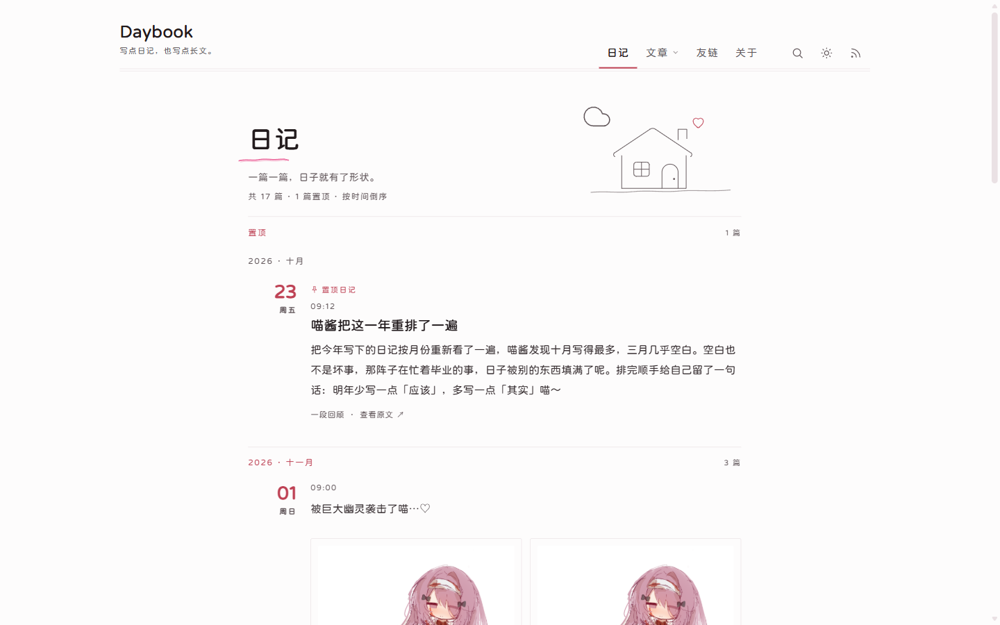
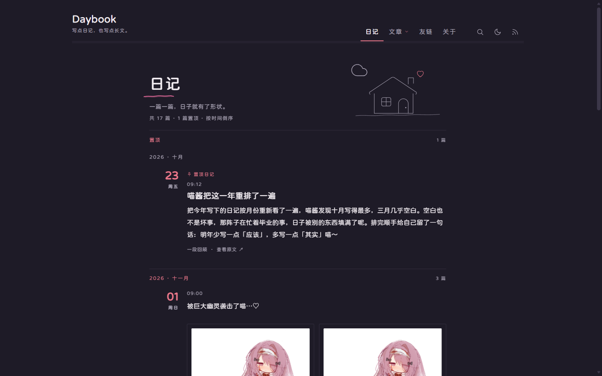
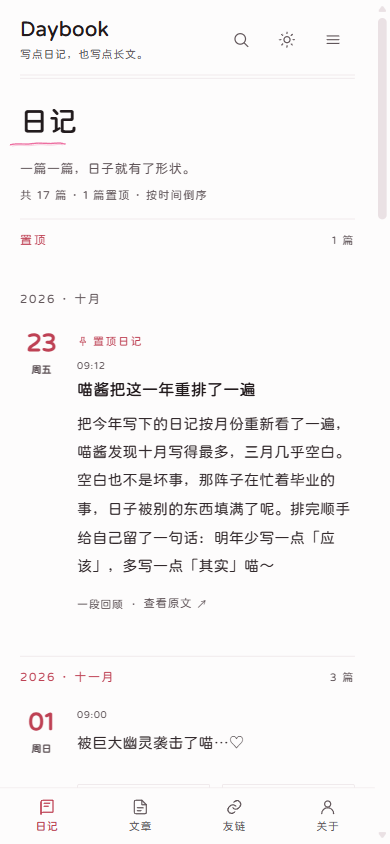
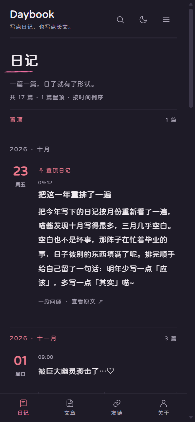
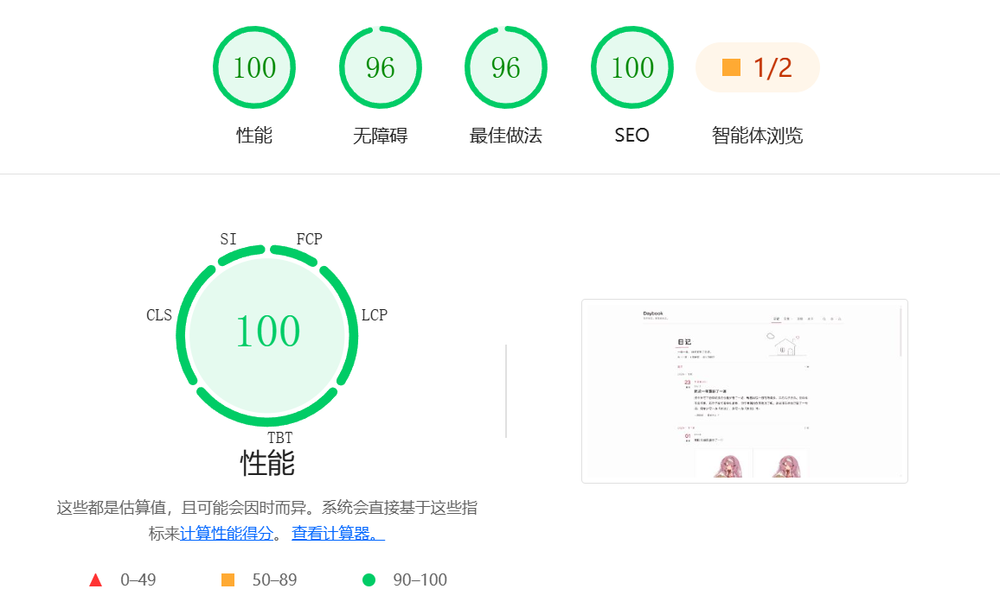

# Daybook

少しずつ読み進められる日記サイト——Astro 製の静的ブログテーマ。毎日を Markdown で書き留めると、静かで素朴な、検索できる個人ブログになります。

**オンラインプレビュー**：<https://daybook.demo.ksable.top/>

[简体中文](./README.md) · [English](./README.en.md) · 日本語 · [繁體中文](./README.zh-TW.md)

---

<table width="100%" align="center">
  <tr>
    <td colspan="3" align="center">
      
      <br>デスクトップ · ライト
    </td>
  </tr>
  <tr>
    <td align="center"><br>デスクトップ · ダーク</td>
    <td align="center"><br>モバイル · ライト</td>
    <td align="center"><br>モバイル · ダーク</td>
  </tr>
  <tr>
    <td colspan="3" align="center">
      
      <br>Lighthouse
    </td>
  </tr>
</table>

---

## 機能

- **日記が中心、記事は別に保存**：1 日 1 本を月ごとに自動でグループ化。長い文章は記事ディレクトリへ。カテゴリ、タグ、キーワードを備えています。
- **静かな紙面とダークモード**：紙のような白、1px の細線、淡いピンクのアクセント。カードも影もありません。ダークモードはシステムに追従し、手動でも切り替えられます。
- **検索・アーカイブ・ヒートマップ**：検索インデックスはビルド時に生成。年月で振り返ることができ、執筆ヒートマップで文字を残した日がわかります。
- **文章を書くための拡張**：脚注、数式、Mermaid、GitHub Alert、折りたたみ、タイムライン、動画とリポジトリの埋め込み。コードのコピー、画像のクリック拡大、本文横の目次。
- **表示のコントロール**：固定、下書き、パスワード保護、そして表示位置ごとの非表示（ホーム、RSS、アーカイブ、検索、タグ、カテゴリ、sitemap）。
- **コメントと配信**：Twikoo、Waline、Artalk に接続できます。3 系統の RSS、sitemap、robots、共有カード。
- **多言語とスマートフォン対応**：1 回のビルドで簡体字中国語・繁体字中国語・English・日本語のいずれかの UI を出力。小さい画面ではナビゲーションがまとまり、ボトムナビゲーションを設定または非表示にできます。
- **テーマとコンテンツのリポジトリ分離（オプション）**：コンテンツリポジトリを独立して clone / pull でき、執筆のコミットがテーマの履歴に混ざりません。

## クイックスタート

Node.js **22.23.4** 以上と [pnpm](https://pnpm.io/) が必要です（`package.json` の `engines` を参照）。

```bash
git clone https://github.com/God-2077/astro-daybook.git
cd astro-daybook
pnpm install
pnpm dev        # http://localhost:4321 を開く
```

起動したら：

1. `src/config/site.ts` を開き、`title`、`url`（実際のドメイン）、`author` を自分のものに変更します。
2. `src/content/daily/` に `.md` ファイルを作り、最初の日記を書きます。必須は `date` だけです。
3. `pnpm build` で `dist/` を生成し、そのフォルダごと任意の静的ホスティングにアップロードします。

最小の日記：

```yaml
---
title: 十一月の最初の一杯のお茶
date: 2026-11-14 21:30:00
---
```

インストールから執筆、ビルドまでの手順は[クイックスタート](./docs/quick-start.md)をご覧ください。

## コンテンツリポジトリ（オプション）

既定の `pnpm dev` と `pnpm build` はテーマ内の `src/content/` を使います。執筆内容を独立した Git リポジトリに置く場合は、コンテンツをそのリポジトリに置き、`.env` の `CONTENT_REPO_URL` で指定してから `pnpm content:clone` で取得し、`pnpm dev:content` / `pnpm build:content` で開発・ビルドします。公式のコンテンツリポジトリ例：<https://github.com/God-2077/astro-daybook-content/>。

手順と制限の全文は[テーマとコンテンツの分離](./docs/dual-repo.md)をご覧ください。

## 設定

| 変更したい内容 | 編集するファイル |
| --- | --- |
| タイトル、サブタイトル、作者、ドメイン、言語、ナビゲーション、ページ送り、コメント、SEO | `src/config/site.ts` |
| 友だちリンクのグループ | `src/config/links.ts` |
| 「このサイトについて」ページの本文 | `src/content/spec/about.mdx` |
| 音楽ページのプレイリスト | `src/content/pages/music.mdx` |
| コンテンツリポジトリの URL、ディレクトリ、ブランチ、SSH 鍵 | `.env` の `CONTENT_REPO_*` |
| コンテンツモードのサイト設定と友だちリンク | `<content root>/config/site.ts`、`<content root>/config/links.ts` |

すべての項目、既定値、検証に失敗したときの扱いは[設定ガイド](./docs/configuration.md)をご覧ください。

## ドキュメント

ドキュメントは簡体字中国語で書かれています。

| やりたいこと | 読むページ |
| --- | --- |
| まず動かす | [クイックスタート](./docs/quick-start.md) |
| 設定、ナビゲーション、コメント、SEO を変える | [設定ガイド](./docs/configuration.md) |
| 日記と記事を書く、frontmatter、パスワード保護 | [執筆ガイド](./docs/writing.md) |
| 脚注、数式、Mermaid、折りたたみを使う | [Markdown 拡張](./docs/markdown.md) |
| ページにプレイリストを置く | [音楽プレーヤー](./docs/music-player.md) |
| 静的ホスティングへデプロイする | [デプロイ](./docs/deployment.md) |
| Vercel とコンテンツリポジトリで自動公開する | [Vercel へのデプロイ](./docs/deployment-vercel.md) |
| テーマとコンテンツを分離する | [テーマとコンテンツの分離](./docs/dual-repo.md) |
| ビルド失敗や検索不調を直す | [トラブルシューティング](./docs/troubleshooting.md) |
| すべてのページとメンテナー向けドキュメント | [ドキュメント一覧](./docs/README.md) |

## 日記をもっと手軽に（オプション）

IDE を開いてファイルを作り、git コマンドを打つのは手間です。[Astro Blog Studio](https://github.com/God-2077/astro-blog-studio) なら、ブラウザ上でリポジトリに接続し、同じディレクトリで執筆、リアルタイムでプレビュー、ワンクリックでコミットできます。リポジトリの構成やビルド設定は変更しません。

## 謝辞

サイトの本文にはフォント [寒蝉全圆体](https://chinese-font.netlify.app/zh-cn/fonts/hcqyt/ChillRoundFRegular) を使用しています。

astro-daybook の開発にインスピレーションと参考を与えてくれたプロジェクト：

- [astro-koharu](https://github.com/cosZone/astro-koharu)
- [Firefly](https://github.com/CuteLeaf/Firefly)
- [Mizuki](https://github.com/LyraVoid/Mizuki)
- [fuwari](https://github.com/saicaca/fuwari)

## License

[GNU Affero General Public License version 3 (AGPL-3.0)](./LICENSE)

サードパーティのリソース：本文中の画像拡大には [lightGallery](https://www.lightgalleryjs.com/)（GPLv3 / 商用のデュアルライセンス。ライセンスの説明は[設定ガイドの「画像拡大」](./docs/configuration.md#图片放大)）を、フォントには寒蝉全圆体のサブセット（OFL-1.1）を使用しています。
