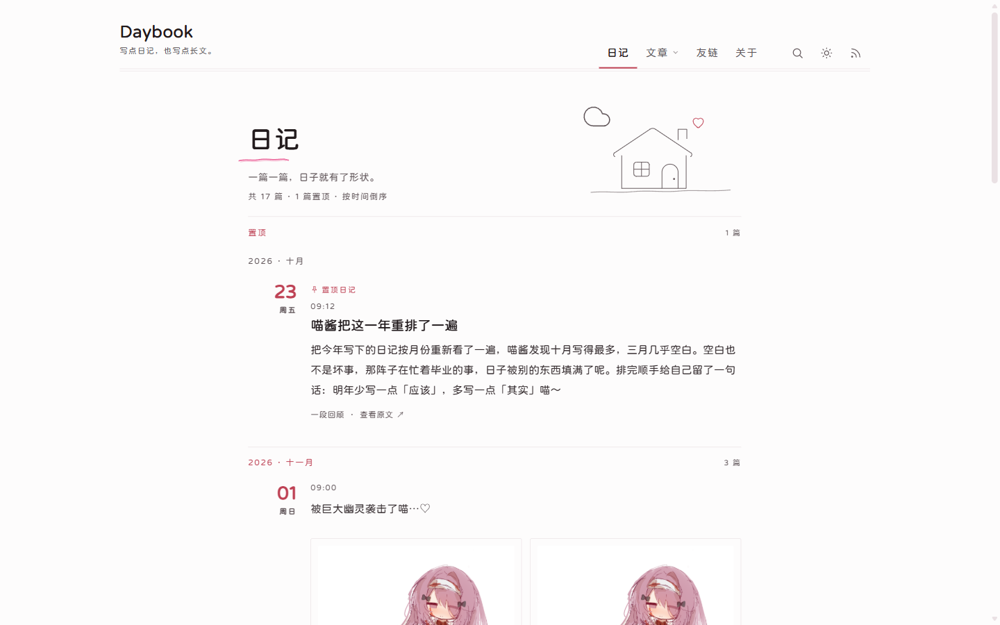
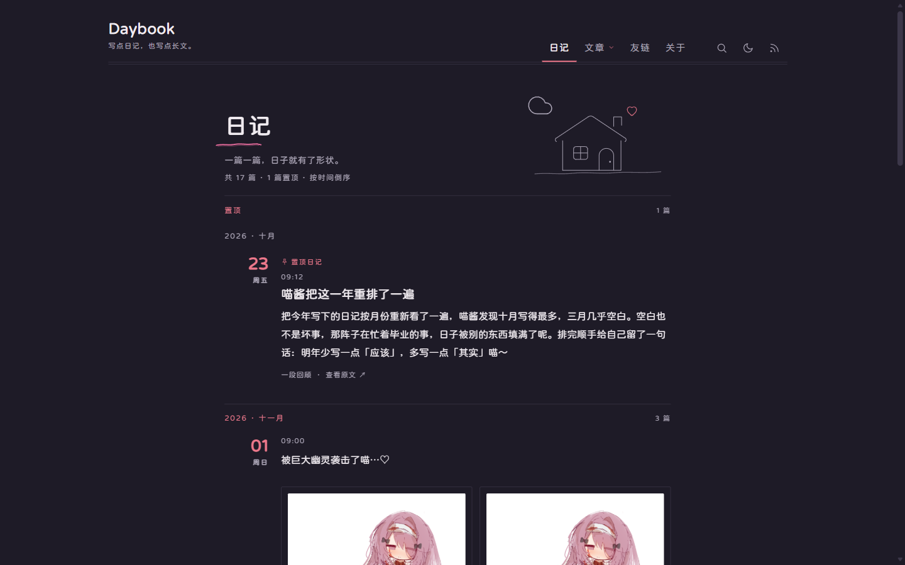
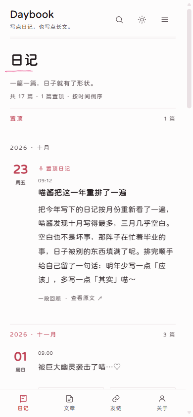

# Daybook

一页可以慢慢读的日记站——一个基于 Astro 的静态博客主题，用 Markdown 写下每天，构建成安静、素净、能搜索的个人博客。

**在线预览**：<https://daybook.demo.ksable.top/>

简体中文 · [English](./README.en.md) · [日本語](./README.ja.md) · [繁體中文](./README.zh-TW.md)

---







---

## 功能特性

- **以日记为主**：一天一篇，自动按月分组，左侧日期栏让时间线一目了然
- **文章另存**：需要写长文时放文章目录，自带分类、标签与关键词
- **安静的设计**：纸白底色、细线分隔、淡粉点缀，没有卡片、描边和阴影
- **深色模式**：跟随系统，也可以手动切换，切换不闪白
- **全文搜索**：构建时生成索引，输入即搜，可按日记、文章、页面筛选
- **置顶与草稿**：置顶日记单独成组；草稿只在本地开发时出现
- **长文自动折叠**：首页只露开头，想读完再点「展开全文」
- **正文增强**：侧边目录、代码高亮、数学公式、图片点开放大、脚注
- **密码保护**：某一篇只想自己看，加一个密码即可
- **评论**：随时接入 Twikoo、Waline 或 Artalk
- **归档与热力图**：按年月回顾全部内容，写作热力图显示哪几天留下了字
- **订阅与分享**：三路 RSS、sitemap、robots，以及链接卡片预览图
- **音乐页**：把喜欢的歌单放进站内播放
- **多语言**：一次构建输出简体中文、繁體中文、English、日本語中的一种界面
- **手机友好**：小屏自动收起导航，底部导航随手切换

## 快速开始

需要 Node.js **22.23.4** 以上与 [pnpm](https://pnpm.io/)。

```bash
git clone https://github.com/God-2077/astro-daybook.git
cd astro-daybook
pnpm install
pnpm dev        # 打开 http://localhost:4321
```

跑起来之后：

1. 打开 `src/config/site.ts`，把标题、副标题、作者和 `url`（真实域名）改成自己的。
2. 在 `src/content/daily/` 里新建一个 `.md` 文件，写下第一篇日记。
3. `pnpm build` 生成 `dist/`，把整个目录上传到任意静态托管即可。

托管平台（Vercel、Cloudflare Pages、Netlify 等）可以直接导入仓库：构建命令填 `pnpm build`，输出目录填 `dist`。详细步骤见[部署说明](./docs/configuration.md#部署)。

## Frontmatter 示例

日记放在 `src/content/daily/`，只有 `date` 必填：

```yaml
---
title: 十一月的第一杯茶
date: 2026-11-01 21:30:00
category: 日常 # 首页/详情/归档里的展示标签
# updated: 2026-11-02 09:00:00
# description: 手写一段摘要，用于 RSS、搜索与分享卡片
# slug:                          # 默认由文件路径生成
# permalink: notes/first-tea     # 覆盖完整 URL
# draft: true                    # 草稿：只在开发时可见
# pin: true                      # 置顶
# password: paper2024            # 加密：输入密码才能读正文
# hideFrom: [home, rss, archive, search, tag, category, sitemap]
# comments: false
---
```

文章放在 `src/content/post/`，`title` 与 `date` 必填，另外支持分类与标签：

```yaml
---
title: 用 Astro 搭一个日记站
date: 2026-10-20 10:00:00
categories: [文章]
tags: [Astro, 前端]
keywords: [静态博客]
---
```

字段全集、可见性矩阵与 URL 规则见 [`docs/content.md`](./docs/content.md)。

## 配置说明

配置都是 TypeScript 文件，改完刷新开发服务器即可生效；字段写错会在构建时直接报错并指出位置。

| 想改什么 | 去哪里 |
| --- | --- |
| 标题、副标题、作者、域名、语言、导航、分页、评论、SEO | `src/config/site.ts` |
| 友链分组 | `src/config/links.ts` |
| 关于页正文 | `src/content/spec/about.mdx` |
| 音乐页歌单 | `src/pages/music.mdx` |

- 全部配置字段、评论接入、部署与安全边界：[`docs/configuration.md`](./docs/configuration.md)
- 内容目录、frontmatter 与可见性：[`docs/content.md`](./docs/content.md)
- 歌单与播放器：[`docs/music-player.md`](./docs/music-player.md)

## 鸣谢

本站正文使用字体 [寒蝉全圆体](https://chinese-font.netlify.app/zh-cn/fonts/hcqyt/ChillRoundFRegular)。

感谢以下项目对 astro-daybook 的开发提供的灵感及参考：

- [astro-koharu](https://github.com/cosZone/astro-koharu)
- [Firefly](https://github.com/CuteLeaf/Firefly)
- [Mizuki](https://github.com/LyraVoid/Mizuki)
- [fuwari](https://github.com/saicaca/fuwari)

## License

[GNU Affero General Public License version 3 (AGPL-3.0)](./LICENSE)

第三方资源：正文图片放大使用 [lightGallery](https://www.lightgalleryjs.com/)（GPLv3 / 商业双许可，授权说明见[文档](./docs/configuration.md#图片放大)），字体为寒蝉全圆体子集（OFL-1.1）。
