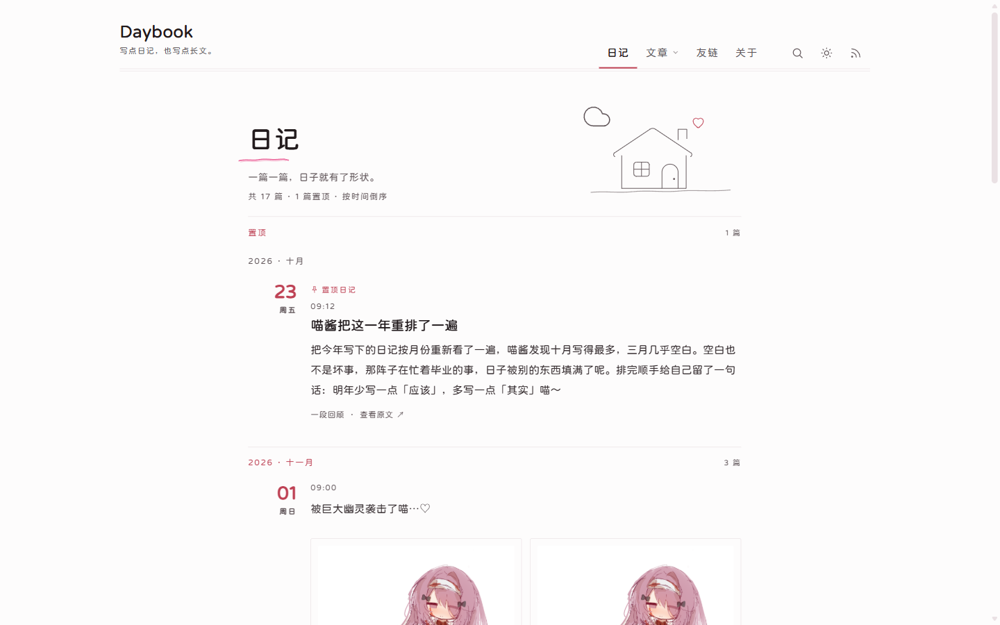
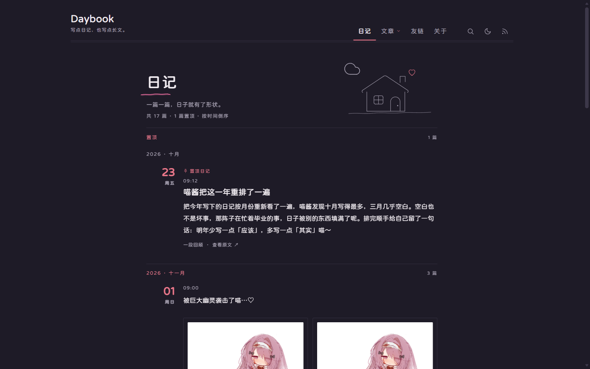
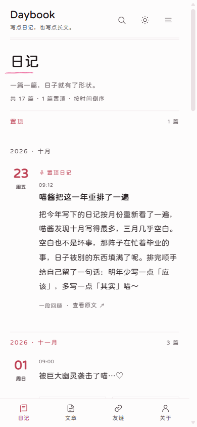
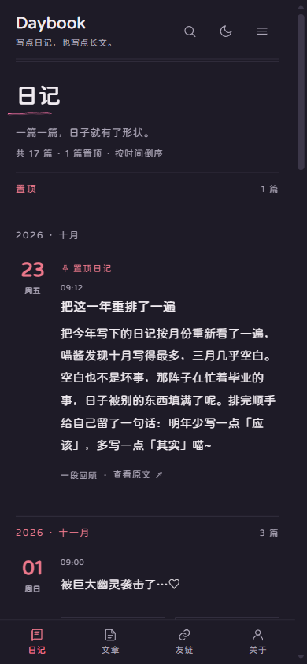
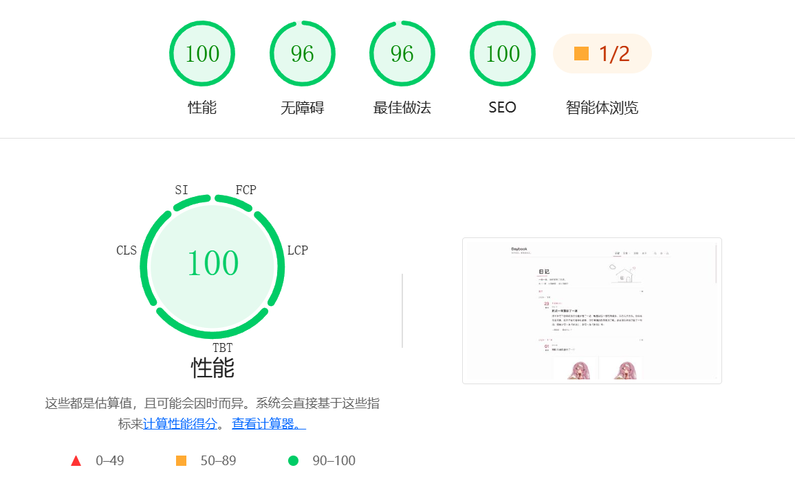

# Daybook

一頁可以慢慢讀的日記站——一個基於 Astro 的靜態部落格主題，用 Markdown 寫下每一天，組成一個安靜、素淨、能搜尋的個人部落格。

**線上預覽**：<https://daybook.demo.ksable.top/>

[简体中文](./README.md) · [English](./README.en.md) · [日本語](./README.ja.md) · 繁體中文

---

<table width="100%" align="center">
  <tr>
    <td colspan="3" align="center">
      
      <br>桌面端 · 淺色
    </td>
  </tr>
  <tr>
    <td align="center"><br>桌面端 · 深色</td>
    <td align="center"><br>行動端 · 淺色</td>
    <td align="center"><br>行動端 · 深色</td>
  </tr>
  <tr>
    <td colspan="3" align="center">
      
      <br>Lighthouse
    </td>
  </tr>
</table>

---

## 功能特色

- **以日記為主，文章另存**：一天一篇，自動按月分組；長文放進文章目錄，內建分類、標籤與關鍵字。
- **安靜紙頁與深色模式**：紙白底色、1px 細線、淡粉點綴，沒有卡片與陰影；深色模式跟隨系統，也可以手動切換。
- **搜尋、歸檔與熱力圖**：建置時產生搜尋索引，輸入即搜；歸檔按年月回顧，熱力圖顯示哪幾天留下了字。
- **寫作增強**：註腳、數學公式、Mermaid、GitHub Alert、折疊區塊、時間軸、影片與儲存庫嵌入；程式碼可複製、圖片點開放大、正文帶側邊目錄。
- **可見性控制**：置頂、草稿、密碼保護，以及按位置隱藏（首頁、RSS、歸檔、搜尋、標籤、分類、sitemap）。
- **評論與訂閱**：隨時接入 Twikoo、Waline 或 Artalk；三路 RSS、sitemap、robots 與分享卡片。
- **多語言與手機友善**：一次建置輸出簡體中文、繁體中文、English、日本語其中一種介面；小螢幕收起導覽，底部導覽可設定或關閉。
- **主題與內容分倉（選用）**：內容儲存庫獨立 clone / pull，寫作提交不混進主題歷史。

## 快速開始

需要 Node.js **22.23.4** 以上與 [pnpm](https://pnpm.io/)（見 `package.json` 的 `engines`）。

```bash
git clone https://github.com/God-2077/astro-daybook.git
cd astro-daybook
pnpm install
pnpm dev        # 開啟 http://localhost:4321
```

跑起來之後：

1. 開啟 `src/config/site.ts`，把 `title`、`url`（實際網域）和 `author` 改成自己的。
2. 在 `src/content/daily/` 新建一個 `.md` 檔案，寫下第一篇日記——只有 `date` 為必填。
3. 執行 `pnpm build` 產生 `dist/`，把整個目錄上傳到任何靜態託管。

最小的一篇日記：

```yaml
---
title: 十一月的第一杯茶
date: 2026-11-14 21:30:00
---
```

完整的安裝、寫作與建置步驟見[快速開始](./docs/quick-start.md)。

## 內容儲存庫（選用）

預設的 `pnpm dev` 與 `pnpm build` 使用主題自帶的 `src/content/`。如果想把寫作內容獨立成 Git 儲存庫：把內容放進獨立儲存庫，在 `.env` 用 `CONTENT_REPO_URL` 指向它，再用 `pnpm content:clone` 拉取、用 `pnpm dev:content` / `pnpm build:content` 建置。官方內容儲存庫範例：<https://github.com/God-2077/astro-daybook-content/>。

完整步驟與限制見[主題與內容分倉](./docs/dual-repo.md)。

## 設定

| 想改什麼 | 去哪裡 |
| --- | --- |
| 標題、副標題、作者、網域、語言、導覽、分頁、評論、SEO | `src/config/site.ts` |
| 友鏈分組 | `src/config/links.ts` |
| 關於頁正文 | `src/content/spec/about.mdx` |
| 音樂頁歌單 | `src/content/pages/music.mdx` |
| 內容儲存庫網址、目錄、分支、SSH 私鑰 | `.env` 的 `CONTENT_REPO_*` |
| 內容模式下的站點設定與友鏈 | `<內容根>/config/site.ts`、`<內容根>/config/links.ts` |

全部欄位、預設值與驗證失敗的處理見[設定說明](./docs/configuration.md)。

## 文件

文件以簡體中文撰寫。

| 我想… | 看 |
| --- | --- |
| 第一次裝起來跑通 | [快速開始](./docs/quick-start.md) |
| 改設定、導覽、評論、SEO | [設定說明](./docs/configuration.md) |
| 寫日記與文章、frontmatter、密碼保護 | [寫作指引](./docs/writing.md) |
| 用註腳、公式、Mermaid、折疊區塊 | [Markdown 增強](./docs/markdown.md) |
| 在頁面裡放歌單 | [音樂播放器](./docs/music-player.md) |
| 部署到靜態託管 | [部署指南](./docs/deployment.md) |
| 用 Vercel + 內容儲存庫自動發布 | [部署到 Vercel](./docs/deployment-vercel.md) |
| 主題與內容分倉 | [雙儲存庫](./docs/dual-repo.md) |
| 建置失敗、搜尋沒結果 | [排錯](./docs/troubleshooting.md) |
| 全部文件與維護者文件 | [文件索引](./docs/README.md) |

## 更快速地寫日記（選用）

覺得開 IDE、手動建立檔案、輸入 git 指令太麻煩，可以試試 [Astro Blog Studio](https://github.com/God-2077/astro-blog-studio)：在瀏覽器裡連結儲存庫，同目錄寫日記、即時預覽、一鍵提交推送。它不會變更儲存庫結構與建置設定。

## 鳴謝

本站正文使用字體 [寒蟬全圓體](https://chinese-font.netlify.app/zh-cn/fonts/hcqyt/ChillRoundFRegular)。

感謝以下專案在 astro-daybook 開發過程中提供的靈感與參考：

- [astro-koharu](https://github.com/cosZone/astro-koharu)
- [Firefly](https://github.com/CuteLeaf/Firefly)
- [Mizuki](https://github.com/LyraVoid/Mizuki)
- [fuwari](https://github.com/saicaca/fuwari)

## License

[GNU Affero General Public License version 3 (AGPL-3.0)](./LICENSE)

第三方資源：正文圖片放大使用 [lightGallery](https://www.lightgalleryjs.com/)（GPLv3 / 商業雙重授權，授權說明見[設定說明的「圖片放大」](./docs/configuration.md#图片放大)），字體為寒蟬全圓體子集（OFL-1.1）。
