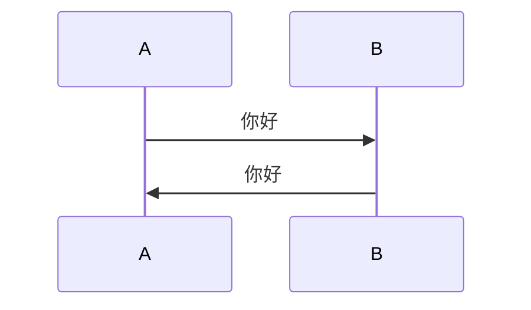

# Markdown 增强

Daybook 的正文管线在 CommonMark 与 GFM 之外加了一组扩展：数学公式、脚注、Mermaid 图表、GitHub Alert、折叠块、指令、仓库与视频嵌入、时间线和若干行内文本指令。这页按写法逐个列出，查语法时用；内容放在哪、frontmatter 怎么写，见[写作指引](./writing.md)。

扩展对 `.md` 与 `.mdx` 都生效：管线固定在 `astro.config.ts` 的 `markdown.processor` 里，两种格式共用同一套 remark / rehype 插件，不需要额外配置。适用于仓库 `main` 分支当前代码（`package.json` 1.2.1）。

## 这页管什么

- 覆盖：CommonMark 与 GFM 之外的正文扩展，以及它们在 `.md` / `.mdx` 里的写法。
- 不覆盖：基础 Markdown 语法；frontmatter、内容目录、URL、可见性与密码保护（见[写作指引](./writing.md)）。
- 不覆盖：Meting-API 的参数、返回结构与缓存（见 [Meting API](./developers/meting-api.md)）；播放器的属性、行为与资源位置（见[音乐播放器](./music-player.md)）。
- 构建期处理：指令由 `remark-directive` 解析，在构建期转换成普通 HTML；浏览器端不解析 Markdown。需要浏览器端脚本的只有 Mermaid 图表、代码复制、GitHub 卡片、视频 iframe、隐藏文字的点击切换与音乐播放器。
- 样式：扩展沿用纸页规则（1px 细线、无圆角、无投影），只有 GitHub Alert 的语义色和音乐播放器卡片是例外。

| 写法 | 作用 |
| --- | --- |
| `$...$`、`$$...$$` | 数学公式 |
| `[^1]` | 脚注 |
| 语言为 `mermaid` 的代码块 | Mermaid 图表 |
| `> [!NOTE]` | GitHub Alert |
| `:underline[...]` 等文本指令 | 行内下划线、键帽、隐藏文字、缩写 |
| `::github{...}`、`::youtube{...}`、`::bilibili{...}`、`::meting{...}`、`::hr` | 叶子指令 |
| `:::note` 等容器指令 | Alert、折叠块、YAML 歌单、时间线 |

## 数学公式

行内公式写在 `$...$` 之间，块级公式写在 `$$...$$` 之间。构建期由 KaTeX 转成 HTML 与 MathML，页面加载样式表但不加载数学 JS，禁用 JavaScript 也能正常显示。

```markdown
行内公式：$E = mc^2$。

块级公式：

$$
\int_{-\infty}^{\infty} e^{-x^2}\,dx = \sqrt{\pi}
$$
```

- 块级公式的 `$$` 各自独占一行，公式内容放在两行之间。
- 正文里要显示美元符号时写成 `\$`。
- 公式写错不会中断构建：KaTeX 在原位显示红色错误提示，构建继续。
- 行内公式字号 1.06em；块级公式上下各一条 1px 细线、水平居中，超宽时在公式区横向滚动（样式在 `src/styles/app.css`，KaTeX 样式表在 `src/layouts/BaseLayout.astro` 引入）。

## 脚注

脚注语法与 GFM 一致：

```markdown
这是一个带脚注的句子[^1]，这是另一个脚注[^note]。

[^1]: 第一个脚注的内容。
[^note]: 命名脚注的内容。
```

- 编号按正文出现顺序生成，正文里渲染成右上角的上标 `[1]`、`[2]`；命名只用于定义处。
- GFM 会自动补一个 “Footnotes” 标题，构建期从正文与目录里移除，脚注区改用 `.a-footnotes` 样式。

## Mermaid

把代码块的语言写成 `mermaid` 就是一个图表：

````markdown

````

- 构建期只输出 `figure.a-mermaid` 与源码 `<pre>`；浏览器端按需加载 Mermaid 后渲染，没有图表的页面不会下载它。
- 图表颜色由站点 CSS 令牌映射成 Mermaid 主题变量，切换浅色 / 深色后按当前主题重绘。
- 渲染使用 `securityLevel: 'strict'`。
- 图表右上角有放大、缩小、恢复与全屏四个按钮：缩放范围 50%–300%，每次 20%；恢复回到 100% 并居中；全屏优先用浏览器 Fullscreen API，被拒绝时退化为固定阅读层，按 Esc 或按钮退出。
- 桌面端未放大（100%）时，指针停在图表上用滚轮 / 触控板只滚动页面；按住 Ctrl 或 Alt 再滚轮，才以指针位置为中心缩放图表。放大后直接滚轮缩放，缩回 100% 后滚轮恢复滚动页面；鼠标拖动只在放大后可平移。
- 触屏未放大时，单指滑动滚动页面，双指捏合放大图表；放大后单指拖动平移图表。全屏查看时页面不可滚动，滚轮与单指手势始终可用。
- `touch-action` 跟随放大状态切换：未放大时 `pan-y` 允许页面滚动，放大后 `none` 把平移与捏合交给图表，全屏查看时始终为 `none`。
- 渲染失败时保留源码并显示本地化错误提示；禁用 JavaScript 时直接看到源码。
- 窄屏下图表在视口内裁剪，不会撑破正文列，放大后通过拖动查看。

## 代码块

- Shiki 在构建期完成高亮，使用 `github-light` 与 `github-dark` 两套主题，跟随站点浅色 / 深色模式；页面不加载高亮 JS。
- 每个代码块包一层 `.a-code-block`，右上角有复制按钮：脚本加载后按钮出现，桌面端悬停或键盘聚焦时显示，触屏设备常显；复制成功后图标切换为勾选，失败时切换为叉号，1.8 秒后恢复。
- 复制按钮不改变 Markdown 写法，也不依赖代码块语言；禁用 JavaScript 时按钮不出现，代码本身不受影响。
- 代码围栏只读语言标记：写在语言后面的 meta（例如 `title="..."` 或 `{1,3}` 行高亮）不会生效。

## 指令

指令有三种形态，冒号数量不能混用：

| 形态 | 写法 | 用途 |
| --- | --- | --- |
| 文本指令 | `:name[内容]{属性}` | 行内元素，如 `:kbd[Ctrl]` |
| 叶子指令 | `::name{属性}` | 独立块，没有结束标记，如 `::github{repo="owner/repo"}` |
| 容器指令 | `:::name[标题]` … `:::` | 包住一段正文，如 `:::note` |

已知指令清单：

| 写法 | 作用 |
| --- | --- |
| `:underline[...]`、`:ins[...]` | 下划线 |
| `:kbd[...]` | 键帽 |
| `:hidden[...]` | 模糊或遮挡文字 |
| `:abbr[...]{title="..."}` | 缩写 |
| `::github{repo="owner/repo"}` | 仓库卡片 |
| `::youtube{id="..."}` | YouTube 嵌入 |
| `::bilibili{id="..."}` | Bilibili 嵌入 |
| `::meting{...}` | Meting 歌单播放器 |
| `::hr` | 实线分隔 |
| `:::note`、`:::tip`、`:::important`、`:::warning`、`:::caution` | GitHub Alert |
| `:::fold[标题]` | 折叠块 |
| `:::music` | YAML 歌单 |
| `::::timeline` 与 `:::event` | 时间线 |

构建时的错误策略：

- 已知指令用错形态（例如把容器写成 `::note`）：中断构建，错误信息提示改用哪种冒号数量。
- 未知指令：不中断构建，记录一条 `[daybook:markdown]` 警告，然后把正文按普通 Markdown 输出；未知叶子指令没有正文可保留，会被忽略。拼错名字不会让构建失败，需要自己检查。
- 必填属性缺失或值不合法：中断构建，错误信息以 `[daybook:markdown]` 开头。

## GitHub Alert

引用块写法沿用 GitHub 的标记：

```markdown
> [!NOTE]
> 说明文字。

> [!WARNING]
> 需要立即注意的内容。
```

- 支持 `NOTE`、`TIP`、`IMPORTANT`、`WARNING`、`CAUTION` 五种类型，标记要用大写，并写在引用块第一段开头。
- 标题由构建期按站点语言插入（简体中文为「说明」「提示」「重要」「警告」「注意」）；引用块写法只能使用默认标题。
- 每种类型有独立图标、标题色与左侧 4px 语义线；这五种语义色是纸页配色的例外。
- 需要自定义标题时改用容器指令，标题保留行内 Markdown：

```markdown
:::note[说明]
默认标题为“说明”，这一段是内容。
:::

:::tip[自定义 **标题**]
容器标题保留行内 Markdown。
:::
```

- 容器写法同样支持 `:::important`、`:::warning`、`:::caution`；省略 `[标题]` 时使用默认标题。

## 折叠块

```markdown
:::fold[使用提示]
如果需要添加并非所有读者都会感兴趣的内容，可以将其放在折叠块中。
:::
```

- 渲染为原生 `<details>` / `<summary>`，默认收起，点击标题展开；键盘与读屏器可直接操作。
- 标题保留行内 Markdown；省略 `[标题]` 时标题为「展开阅读」（简体中文）。
- 正文按普通 Markdown 渲染，可以放列表、代码块、Alert、Mermaid 等其他扩展。

## 仓库与视频嵌入

### GitHub 仓库

```markdown
::github{repo="God-2077/astro-daybook"}
```

- `repo` 必填，必须是 `owner/repo`，只允许字母、数字、下划线、短横线与点。
- 构建期只输出静态卡片骨架：仓库名、GitHub 图标、star / fork / 许可证占位和「在 GitHub 查看仓库」的降级文案。
- 卡片进入视口 200px 内才请求 `https://api.github.com/repos/{repo}`，超时 8 秒；成功后填入描述、头像、star、fork 与许可证，失败时保留骨架，不显示空字段。
- 结果按仓库缓存在 `sessionStorage` 的 `daybook:github:<repo>` 下 24 小时；同一仓库的并发请求会合并。
- 请求不带凭据，也不发送 token（`credentials: 'omit'`）；未认证请求受 GitHub API 速率限制，只适合公开仓库。

### YouTube 与 Bilibili

```markdown
::youtube{id="R401j1QAvEg"}

::bilibili{id="BV1sK4y1Z7KG" autoload="false"}
```

- `id` 必填：YouTube 是 6–20 位字母、数字、下划线或短横线；Bilibili 是 `BV` 加 10 位字母数字。
- `autoload` 只接受 `true` / `false`，默认 `true`：页面脚本加载后立即创建播放器 iframe，并移除封面、平台标签与播放按钮。
- `autoload="false"`：保留封面，严格等点击后才创建带自动播放的 iframe。
- iframe 地址：YouTube 用 `youtube-nocookie.com`，Bilibili 用 `player.bilibili.com`；YouTube 封面来自 `i.ytimg.com`，封面加载失败时隐藏图片。
- 构建期输出封面、平台标签与播放按钮；禁用 JavaScript 时它是指向原视频的普通链接。
- 需要访客能访问对应平台域名。

## 音乐播放器

Markdown 里有两种写法：

```markdown
::meting{id="8900628861" server="netease" type="playlist" autoPlayNext="true"}
```

```markdown
:::music
- name: 光るなら
  artist: Goose house
  url: https://k-pan.edgeone.ksable.top/public/astro-daybook/music/hikarunara.mp3
:::
```

`::meting` 的属性：

| 属性 | 必填 | 默认 | 说明 |
| --- | --- | --- | --- |
| `id` | 是 | — | 歌单或歌曲 ID；只允许字母、数字、下划线与短横线 |
| `server` | 否 | `netease` | 数据源；只允许字母、数字、下划线与短横线 |
| `type` | 否 | `playlist` | `song`、`playlist`、`albumlist` |
| `autoPlayNext` | 否 | `false` | 只接受 `true` / `false`；只写属性名按 `false` 处理 |
| `playlistExpand` | 否 | `false` | 只接受 `true` / `false`；只写属性名按 `false` 处理 |

- `::meting` 只输出浏览器端空壳：构建期不请求接口，由访客浏览器向 Meting-API 取数；取数完成前按钮不可用，标题与曲目数量显示「正在加载音乐…」。
- `::meting` 不支持 `search`，也不能在构建期取数；这两种需求用 MDX 的 `meting.player()`（见[音乐播放器](./music-player.md)）。
- `:::music` 在构建期解析容器里的 YAML 列表并输出同一套播放器 DOM；字段、属性与交互见[音乐播放器](./music-player.md)。
- Meting-API 的地址、参数、返回结构与缓存见 [Meting API](./developers/meting-api.md)。

## 行内文本指令

```markdown
:underline[下划线文字]
:ins[插入文字]
:underline[波浪下划线]{type="wavy"}
:kbd[Ctrl]
:hidden[默认模糊]
:hidden[黑条遮挡]{type="background"}
:abbr[HTML]{title="HyperText Markup Language"}
```

- `:underline` 与 `:ins` 默认实线下划线；`type` 可选 `line`、`wavy`、`dot`、`dashed`、`double`，分别对应实线、波浪线、描点线、虚线与双实线。
- `:kbd` 渲染成等宽字体的键帽，适合写键盘快捷键。
- `:hidden` 的 `type` 可选 `blur`（默认，`blur(4px)`）与 `background`（用前景色遮挡）；鼠标悬停、键盘聚焦，或点击 / Enter / Space 时切换显示；触屏设备没有 hover，以点击为准。
- `:abbr` 用 `title` 给出缩写全称；缺少 `title` 时只记录警告，缩写照常显示。
- `type` 取值不合法会中断构建。
- 隐藏文字不是安全边界：原文仍在页面 HTML 里，也可能出现在 RSS 与自动摘要中，不要用它保存敏感信息。

## 分隔线 ::hr

```markdown
::hr

::hr{.red}
```

- `::hr` 生成 `<hr class="a-md-hr">`，在正文里是实线；普通 `---` 仍是主题默认的虚线。
- `{.red}` 给分隔线加 `.red` 类，使用 `--rose` 的淡色实线。
- 其它类名会写进 `class`，但仓库只给 `.red` 定义了样式。

## 时间线

外层用 4 个冒号，事件用 3 个；`date` 必填（`YYYY-MM-DD`），`title` 可选，事件正文支持 Markdown。

```markdown
::::timeline

:::event{date="2026-11-01" title="新的一天"}
早上起来，天气很好。
:::

:::event{date="2026-11-03"}
没有标题的事件。
:::

::::
```

- 日期在构建期校验为真实日历日期，渲染为左侧 `MM.DD` 与年份，并保留 `<time datetime="YYYY-MM-DD">` 语义。
- `::::timeline` 里只能放 `:::event`，至少一个；不接受属性，也不支持 `[标题]`。
- `:::event` 只接受 `date` 与 `title` 两个属性，不支持 `[标题]` 写法，不能出现在时间线之外。
- 时间线与事件不能互相嵌套。
- 外层只写 3 个冒号会中断构建，错误信息提示改用 4 个冒号。

## 表格与排版

- GFM 表格使用 1px 细线；构建期给表格包一层 `.a-table-wrap`，宽表格在纸面内横向滚动。
- 任务列表（`- [x]`）渲染成带勾选框的列表；引用块使用 1px 左边线。
- 正文 `h2` 在构建期前置 ✦ 装饰、末尾追加锚点链接（`aria-label="本节链接"`）；目录只收录 `h2`，并且只在日记与文章详情页出现，独立页面与关于页没有目录。
- 普通 `---` 是虚线分隔；需要实线时用 `::hr`。
- 图片、链接与首页摘要的排版规则见[写作指引](./writing.md)。
- 表格、脚注、`::hr`、行内指令等扩展样式在首页日记摘要与详情页正文共用，展开日记时不会出现另一套排版。

## 在 MDX 里同样可用

`.md` 与 `.mdx` 共用 `astro.config.ts` 里的 `markdown.processor`，上面的语法在 `.mdx` 里同样可用；指令在 MDX 中被编译成真实元素，而不是原始的 HTML 字符串。

```mdx
:::note[MDX 也支持]
指令会在构建期转换成普通元素。
:::

::github{repo="withastro/astro"}
```

- `.mdx` 里还可以导入组件：`import { Figure, MusicPlayer } from '@ui'` 使用通用展示组件；`import { meting } from '@mdx'` 在构建期取数或渲染播放器；`@mdx/client` 用于浏览器端脚本。
- 需要构建期能力（例如 `meting.player({ client: false })`、`Figure`）时用 MDX 组件；同一页面里组件与指令可以混用。
- `:::music` 的内容按 YAML 解析，不要把 Markdown、MDX 组件或表达式写进去。

## 外部请求与隐私

| 写法 | 请求目标 | 触发时机 |
| --- | --- | --- |
| `::github` | `api.github.com` | 卡片进入视口 200px 内 |
| `::youtube` | `i.ytimg.com`（封面）、`youtube-nocookie.com`（iframe） | 封面懒加载；iframe 在 `autoload` 为 `true` 时页面加载后创建，为 `false` 时点击后创建 |
| `::bilibili` | `player.bilibili.com`（iframe） | 与 YouTube 相同 |
| `::meting` | 站点配置 `mdx.meting.api` 指向的 Meting-API（默认 `https://163.hyc.moe/`） | 访客浏览器加载播放器时 |
| `:::music`、`MusicPlayer` | 你填写的音频、封面、歌词地址 | 浏览器按需加载 |

- 站点不代理这些请求；第三方域名需要访客自己能访问，隐私政策由对方决定。
- 管线不做 HTML 清洗：`.md` 里直接写的 HTML 会原样进入页面；只写自己维护的内容。
- 隐藏文字与配置里的 `inject.headEnd` / `inject.bodyEnd` 都不是安全边界，敏感信息与不可信 HTML 都不要依赖它们；边界说明见[配置说明](./configuration.md#安全边界)。

## 常见构建错误

以下错误会中断构建，错误信息以 `[daybook:markdown]` 开头：

| 错误信息（片段） | 原因与改法 |
| --- | --- |
| `note 是 容器（:::name ... :::） 指令，请调整冒号数量。` | 指令形态用错，按「指令」一节的表格改正冒号数 |
| `::github 需要 repo="owner/repo"。` | 缺 `repo`，补成 `owner/repo` |
| `::github 的 repo 必须是 owner/repo。` | `repo` 里有非法字符 |
| `::youtube 需要 id。` / `::youtube 的 id 不合法。` | 缺 `id`，或格式不符合 6–20 位字母数字等规则 |
| `::bilibili 的 id 必须是 BV 号。` | 写成 `BV` 加 10 位字母数字 |
| `::youtube 的 autoload 只接受 true 或 false。` | 只写 `true` / `false` |
| `::meting 的 type 只能是 song、playlist 或 albumlist。` | 改成这三种之一；`search` 用 `meting.player()` |
| `::::timeline 里只能放 :::event。` | 时间线里出现了其它容器指令 |
| `:::event 的 date 必须写成 YYYY-MM-DD。` | 改日期格式 |
| `:::event 的 date 不是有效日期：2026-02-30。` | 换成真实日历日期 |
| `:::music 必须包含 YAML 列表。` | 容器里放 YAML 列表，不要放 Markdown 正文 |
| `:::music 的 YAML 解析失败：...` | 修 YAML 缩进与语法 |
| `:::music playlist[0].url is required` | 某首曲目缺 `name` 或 `url` |
| `:underline 的 type 只能是 line、wavy、dot、dashed 或 double。` | 改 `type` 取值 |
| `:hidden 的 type 只能是 blur 或 background。` | 改 `type` 取值 |

不中断构建的情况：

- 未知指令：记录 `[daybook:markdown]` 警告后按普通 Markdown 输出（未知叶子指令被忽略）；拼写错误不会让构建失败。
- `:abbr` 缺 `title`：记录警告，缩写照常输出。
- 公式写错：KaTeX 在原位显示红色错误提示，构建继续。

相关页面：[写作指引](./writing.md)、[音乐播放器](./music-player.md)、[Meting API](./developers/meting-api.md)、[配置说明](./configuration.md)、[文档索引](./README.md)。
