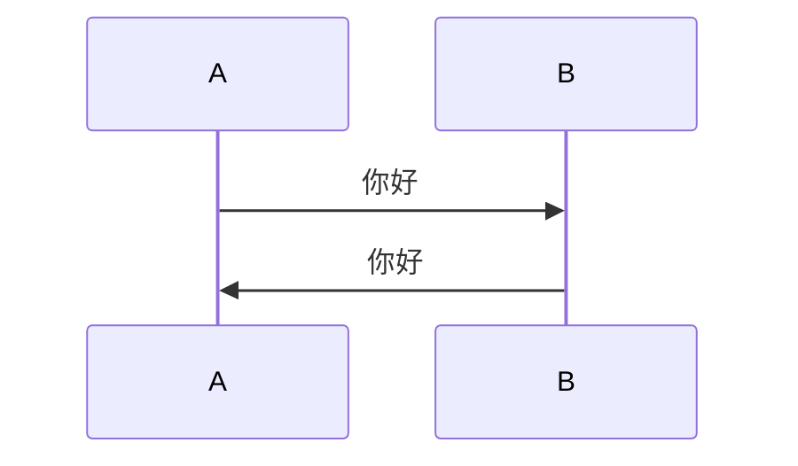

# Markdown 扩展

Daybook 的正文管线在 CommonMark / GFM 之外提供了一小组扩展：脚注方括号、Mermaid 图表、remark-directive 三类指令、GitHub Alert、折叠块、仓库与视频嵌入、音乐播放器，以及几个行内文本指令。它们同时适用于 `.md` 与 `.mdx`；样式沿用日记纸页的 1px 细线、无圆角与无投影，只有 GitHub Alert 的语义色和音乐播放器是经确认的例外。

指令由 [remark-directive](https://github.com/remarkjs/remark-directive) 解析，构建期转换成普通 HTML 结构；不依赖客户端 Markdown 解析。除音乐播放器、GitHub 卡片和视频外，大多数扩展在禁用 JavaScript 时仍保持可读。

## 脚注

脚注语法与 GFM 一致，正文中的编号会自动包上方括号：

```markdown
这是一个带脚注的句子[^1]，这是另一个脚注[^note]。

[^1]: 这是第一个脚注的内容。
[^note]: 这是命名脚注的内容。
```

正文里渲染为右上角的 `[1]`、`[2]`，脚注区仍由 `.a-footnotes` 的细线与小字号承接。编号由 Markdown 解析器按出现顺序生成，命名只用于定义处。

## Mermaid

把代码块语言写成 `mermaid` 即会生成图表容器：

````markdown

````

- 图表在浏览器端按需加载 Mermaid 并渲染，首屏不会为没有图表的页面付出下载成本。
- 明暗主题切换时自动按当前 CSS 令牌重绘，颜色跟随站点，不引入独立配色。
- 渲染失败时保留源码并显示本地化错误提示；禁用 JavaScript 时也能直接看到源码。
- 图表容器可横向滚动，避免窄屏溢出。

## 指令

指令有三种形态，冒号数量不能混用：

| 形态 | 写法 | 用途 |
| --- | --- | --- |
| 文本指令 | `:name[内容]{属性}` | 行内元素，如 `:kbd[Ctrl]` |
| 叶子指令 | `::name{属性}` | 独立块，没有结束标记，如 `::github{repo="owner/repo"}` |
| 容器指令 | `:::name[标题]` … `:::` | 包住一段正文，如 `:::note` |

构建时的错误策略：

- 已知指令用错形态（例如把容器写成 `::note`）会中断构建，并提示应使用的冒号数量。
- 未知指令只输出构建警告，然后把内容按普通 Markdown 展开，不会丢掉正文。
- 必填属性缺失或值不合法会中断构建，并在错误信息中带上 `[daybook:markdown]` 前缀与源位置。

## GitHub Alert

沿用 GitHub 的引用块写法：

```markdown
> [!NOTE]
> Useful information that users should know.

> [!WARNING]
> Urgent info that needs immediate user attention.
```

支持 `NOTE`、`TIP`、`IMPORTANT`、`WARNING`、`CAUTION` 五种类型。每种类型都有独立的图标、标题色与左侧 4px 语义线；五色采用 GitHub 的语义色（蓝、绿、紫、黄、红），是本页纸主题里经确认的配色例外。

也可以使用容器指令，并自定义标题：

```markdown
:::note[说明]
默认标题为“说明”，这一段是内容。
:::

:::tip[自定义 **标题**]
容器标题保留行内 Markdown。
:::
```

同等写法还有 `:::tip`、`:::important`、`:::warning`、`:::caution`。引用块形式只使用默认标题；需要自定义标题时改用容器形式。

## 折叠块

```markdown
:::fold[使用提示]
如果需要添加并非所有读者都会感兴趣的内容，可以将其放在折叠块中。
:::
```

渲染为原生 `<details>` / `<summary>`，默认收起，点击标题展开；键盘与读屏器可直接操作。标题支持行内 Markdown。

## 仓库与视频嵌入

### GitHub 仓库

```markdown
::github{repo="radishzzz/astro-theme-retypeset"}
```

- `repo` 必须是 `owner/repo`，只接受字母、数字、下划线、短横线和点。
- 构建期输出静态卡片骨架：仓库名、GitHub 图标、star/fork/license 占位与“在 GitHub 查看仓库”的降级文案。
- 卡片滚入视口后，浏览器请求 `api.github.com/repos/{repo}` 补充描述、头像、star、fork 与 license；结果缓存在 `sessionStorage` 24 小时。
- 未认证请求受 GitHub 每小时 60 次的限流；请求失败或超时时保留静态骨架，不显示破图或空字段。
- 只适合公开仓库；不读取私有仓库，也不发送任何 token。

### YouTube 与 Bilibili

```markdown
::youtube{id="R401j1QAvEg"}

::bilibili{id="BV1sK4y1Z7KG"}
```

- 初始只渲染封面/标签与播放按钮，点击后才创建 `iframe`，避免第三方脚本和视频在页面加载时一起下载。
- YouTube 使用 `youtube-nocookie.com` 的嵌入地址，并申请自动播放；Bilibili 使用官方 `player.bilibili.com` 地址。
- YouTube 封面来自 `i.ytimg.com`；封面加载失败时自动隐藏图片，只保留标签与播放键。
- 两个平台都需要访客能访问对应域名；禁用 JavaScript 时展示跳转原视频的普通链接。
- `id` 会做白名单校验：YouTube 只接受 6–20 位的字母、数字、下划线与短横线，Bilibili 只接受 `BV` 开头的 12 位视频号。

## 音乐播放器

### Meting

```markdown
::meting{id="8900628861" server="netease" type="playlist" autoPlayNext="true" playlistExpand="true"}
```

- `id` 必填，只接受字母、数字、下划线与短横线。
- `server` 默认 `netease`；`type` 可选 `song`、`playlist`、`albumlist`，默认 `playlist`。
- `autoPlayNext` 与 `playlistExpand` 只接受 `true` / `false`，默认关闭。
- 构建期只输出播放器骨架，浏览器再通过站点的 Meting 客户端取数；接口、超时与缓存配置见 [`meting.md`](./meting.md)。
- 等价于 MDX 里的 `meting.player({ ... })` 调用；需要构建期取数时继续用 MDX 写法。

### 本地 YAML 歌单

```markdown
:::music
- name: 光るなら
  artist: Goose house
  url: https://example.com/hikarunara.mp3
  cover: https://example.com/hikarunara.jpg
  lrc: https://example.com/hikarunara.lrc
- name: トリカゴ
  artist: Goose house
  url: https://example.com/torikago.mp3
:::
```

- 容器内必须是 YAML 列表，字段与 [`MusicPlayer.astro`](../src/components/content/MusicPlayer.astro) 的 `playlist` 一致：`name`、`url` 必填，`artist`、`cover`、`lrc` 可选。
- 构建期解析 YAML 并输出与 MDX 播放器相同的 DOM；音频、封面与歌词仍由浏览器按需加载。
- 表格、列表等普通 Markdown 不要放进该容器；`:::music` 的内容按 YAML 读取，不按 Markdown 渲染。
- 歌单示例与版权说明见 [`music-player.md`](./music-player.md)。

## 行内文本指令

```markdown
:underline[下划线文字]
:ins[插入文字]
:underline[波浪下划线]{type="wavy"}
:underline[描点下划线]{type="dot"}
:kbd[Ctrl]
:hidden[默认模糊]
:hidden[黑条遮挡]{type="background"}
:abbr[HTML]{title="HyperText Markup Language"}
```

- `:underline` 与 `:ins` 默认实线下划线；`type` 可选 `line`、`wavy`、`dot`。
- `:kbd` 渲染为等宽字体的键帽，适合同步键盘快捷键。
- `:hidden` 默认用 `blur(4px)` 模糊，`type="background"` 用前景色黑条遮挡；鼠标悬停或键盘聚焦时显示。
- `:abbr` 使用 `title` 属性给出缩写全称；缺少 `title` 时只发出构建警告。
- 隐藏文字只是阅读层的遮挡，**不是安全边界**：原文仍在 HTML、RSS 和 Pagefind 搜索索引中，敏感信息不要使用。

## `::hr`

```markdown
::hr

::hr{.red}
```

生成细线分隔，默认使用正文的实线；`.red` 使用 `--rose` 的淡色实线，作为章节之间的轻量标记。

## MDX

MDX 继承 `astro.config.ts` 的 `markdown.processor`，因此上面的脚注、Mermaid、指令与 Alert 在 `.mdx` 里同样可用；指令会被编译成真实标签，而不是原始 HTML 字符串。例如：

```mdx
:::note[MDX 也支持]
指令会在构建期转换成普通元素。
:::

::github{repo="withastro/astro"}
```

需要构建期能力（例如 `meting.player()`、`Figure`、`Timeline`）时继续使用 MDX 组件；两套写法可以混用，但不要把组件写在 `:::music` 的 YAML 内容里。

## 安全与外部请求

- `::github`、`::youtube`、`::bilibili`、`::meting` 与 `:::music` 会在浏览器访问第三方域名；站点本身不代理这些请求。
- GitHub 卡片只公开读取仓库元数据；YouTube 与 Bilibili 的 `iframe` 由平台提供，受对应平台的隐私政策约束。
- `inject.headEnd` / `inject.bodyEnd` 与本扩展无关；这些注入点仍按原样输出，不转义。
- 隐藏文字不是加密，也不参与可见性（`hideFrom`）或密码保护逻辑。
