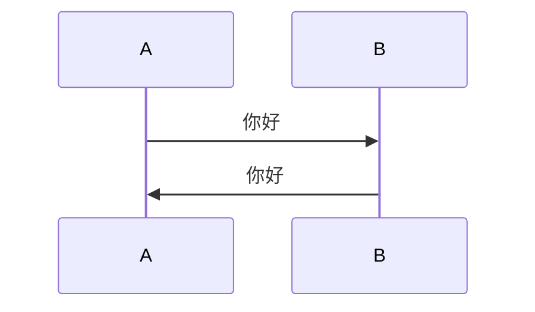

> 这份文件用于逐项检查 Daybook 的 Markdown 扩展，渲染结果以 docs/markdown.md 的描述为准。

## 脚注

这是一个带脚注的句子[^1]，这是另一个脚注[^note]。

[^1]: 这是第一个脚注的内容。
[^note]: 这是命名脚注的内容。

::hr

## Mermaid

## GitHub Alert

> [!NOTE]
> Useful information that users should know.

> [!WARNING]
> Urgent info that needs immediate user attention.

:::note[说明]
默认标题为“说明”，这一段是内容。
:::

:::tip[自定义 **标题**]
容器标题保留行内 Markdown。
:::

::hr

## 折叠块

:::fold[使用提示]
如果需要添加并非所有读者都会感兴趣的内容，可以将其放在折叠块中。
:::

## 仓库与视频嵌入

::github{repo="withastro/astro"}

::youtube{id="R401j1QAvEg"}

::bilibili{id="BV1sK4y1Z7KG"}

::hr

## Meting 播放器

::meting{id="8900628861" server="netease" type="playlist" autoPlayNext="true" playlistExpand="true"}

## 本地 YAML 歌单

:::music
- name: 光るなら
  artist: Goose house
  url: https://k-pan.edgeone.ksable.top/public/astro-daybook/music/hikarunara.mp3
  cover: https://k-pan.edgeone.ksable.top/public/astro-daybook/music/hikarunara.jpg
  lrc: https://k-pan.edgeone.ksable.top/public/astro-daybook/music/hikarunara.lrc
- name: トリカゴ
  artist: Goose house
  url: https://k-pan.edgeone.ksable.top/public/astro-daybook/music/darling.mp3
  cover: https://k-pan.edgeone.ksable.top/public/astro-daybook/music/darling.jpg
  lrc: https://k-pan.edgeone.ksable.top/public/astro-daybook/music/darling.lrc
- name: 前前前世
  artist: RADWIMPS
  url: https://k-pan.edgeone.ksable.top/public/astro-daybook/music/yourname.mp3
  cover: https://k-pan.edgeone.ksable.top/public/astro-daybook/music/yourname.jpg
  lrc: https://k-pan.edgeone.ksable.top/public/astro-daybook/music/yourname.lrc
:::

::hr

## 行内文本指令

普通文字、:underline[下划线文字]、:ins[插入文字]。

:underline[波浪下划线]{type="wavy"} 与 :underline[描点下划线]{type="dot"}。

按下 :kbd[Ctrl] + :kbd[C] 复制。

:hidden[默认模糊]，:hidden[黑条遮挡]{type="background"}，鼠标悬停或键盘聚焦时显示。

:abbr[HTML]{title="HyperText Markup Language"} 是网页的标记语言。

::hr{.red}

## 收尾

如果上面每一节都按预期渲染，说明 Markdown 管线工作正常。
