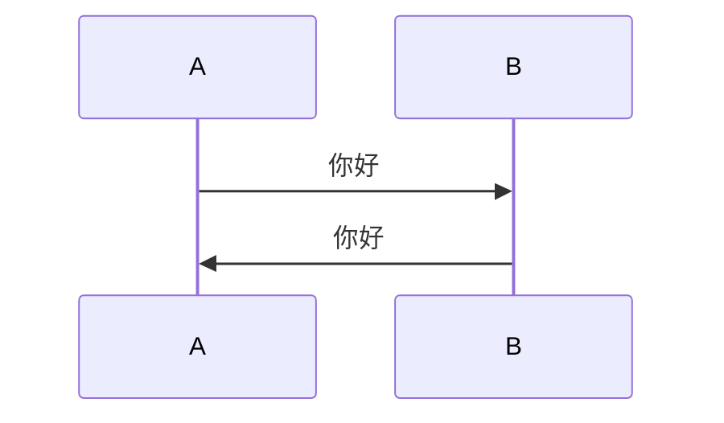
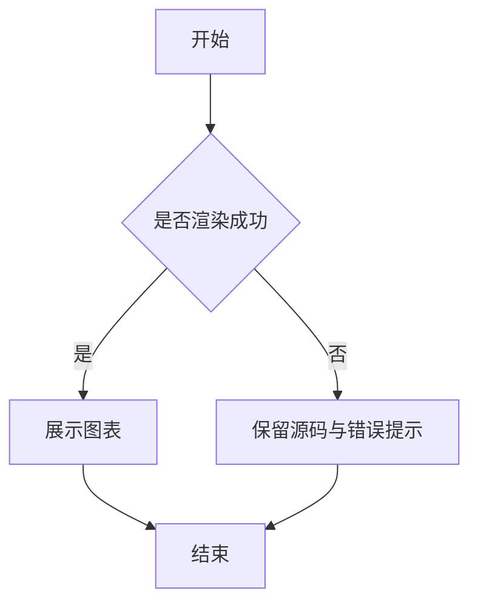

这是一篇用于验证 Daybook 正文管线全部扩展语法的测试文章。包含基础用法、边界写法与多种嵌套组合。

## 脚注

正文中的编号会自动包上方括号：这是一个带脚注的句子[^1]，这是另一个脚脚注[^note]，还有一个复用的编号[^1]。

[^1]: 这是第一个脚脚注的内容，可以被多次引用。
[^note]: 这是命名脚注的内容，命名只用于定义处。

## Mermaid



再放一个流程图，验证不同图类型：



## GitHub Alert

> [!NOTE]
> Useful information that users should know.

> [!TIP]
> 一条提示，带脚注引用[^alert-note]。

> [!IMPORTANT]
> 重要信息。

> [!WARNING]
> Urgent info that needs immediate user attention.

> [!CAUTION]
> 需要谨慎操作的内容。

[^alert-note]: 位于 Alert 内部的脚注，用来测试跨块的脚注解析。

使用容器指令并自定义标题：

```markdown
:::note[说明]
默认标题为“说明”，这一段是内容。
:::
```

实际渲染：

:::note[说明]
默认标题为“说明”，这一段是内容。
:::

:::tip[自定义 **标题**]
容器标题保留行内 Markdown，例如 :kbd[Ctrl] + :kbd[S]。
:::

:::important
也可以省略标题，使用默认标题。
:::

:::warning
带 `:abbr` 的警告：:abbr[HTML]{title="HyperText Markup Language"}。
:::

:::caution
最后一种语义色。
:::

## 指令的三种形态

| 形态 | 写法 | 用途 |
| --- | --- | --- |
| 文本指令 | `:name[内容]{属性}` | 行内元素，如 :kbd[Ctrl] |
| 叶子指令 | `::name{属性}` | 独立块，如 `::github{repo="owner/repo"}` |
| 容器指令 | `:::name[标题]` … `:::` | 包住一段正文，如 `:::note` |

## 折叠块

:::fold[使用提示]
如果需要添加并非所有读者都会感兴趣的内容，可以将其放在折叠块中。
:::

标题支持行内 Markdown 与行内指令：

:::fold[**快捷键** 与 :kbd[Ctrl] + :kbd[C]]
折叠块内部可以放任意正文，例如列表：

- 第一项
- 第二项 :underline[带下划线]{type="wavy"}
:::

## 仓库与视频嵌入

### GitHub 仓库

::github{repo="God-2077/astro-daybook"}

::github{repo="withastro/astro"}

### YouTube 与 Bilibili

::youtube{id="R401j1QAvEg"}

::bilibili{id="BV1sK4y1Z7KG"}

默认会在页面加载后预创建播放器 iframe；加上 `autoload="false"` 可以等到点击才创建：

::youtube{id="R401j1QAvEg" autoload="false"}

## 代码块

代码块右上角会在脚本加载后出现复制按钮：

```js
const greeting = 'Hello, Daybook';
console.log(greeting);
```

## 音乐播放器

### Meting

::meting{id="8900628861" server="netease" type="playlist" autoPlayNext="true" playlistExpand="false"}

### 本地 YAML 歌单

:::music
- name: 光るなら
  artist: Goose house
  url: https://k-pan.edgeone.ksable.top/public/astro-daybook/music/hikarunara.mp3
  cover: https://k-pan.edgeone.ksable.top/public/astro-daybook/music/hikarunara.jpg
  lrc: https://k-pan.edgeone.ksable.top/public/astro-daybook/music/hikarunara.lrc
- name: トリカゴ
  artist: Goose house
  url: https://k-pan.edgeone.ksable.top/public/astro-daybook/music/torikago.mp3
:::

## 行内文本指令

:underline[下划线文字]、:ins[插入文字]、:underline[波浪下划线]{type="wavy"}、:underline[描点下划线]{type="dot"}、:underline[虚线下划线]{type="dashed"}、:underline[双线下划线]{type="double"}、:kbd[Ctrl]、:hidden[默认模糊]、:hidden[黑条遮挡]{type="background"}、:abbr[HTML]{title="HyperText Markup Language"}。

在表格中：

| 指令 | 渲染效果 |
| --- | --- |
| `:kbd[Enter]` | :kbd[Enter] |
| `:underline[下划线]{type="dot"}` | :underline[下划线]{type="dot"} |
| `:ins[插入]` | :ins[插入] |
| `:underline[双线]{type="double"}` | :underline[双线]{type="double"} |
| `:abbr[CSS]{title="Cascading Style Sheets"}` | :abbr[CSS]{title="Cascading Style Sheets"} |
| `:hidden[模糊]` | :hidden[模糊] |

> [!TIP]
> Alert 内也可以使用行内指令：按 :kbd[Esc] 退出，或按住 :kbd[Shift] 多选。

## `::hr`

::hr

::hr{.red}

## 嵌套综合测试

### 折叠块 → Alert

:::fold[折叠中的 Alert]
> [!WARNING]
> 折叠块内的警告，展开后才可见。

> [!NOTE]
> 第二条引用块。
:::

### 容器指令 → 容器指令

:::note[外层容器]
外层内容。

:::tip[内层容器]
内层内容，标题保留 :kbd[Ctrl] 这类行内指令。
:::

外层收尾。
:::

### 列表 → 行内指令 → 脚注

- 列表项 A：:underline[重点]{type="wavy"}，并引用脚脚注[^list-note]。
- 列表项 B：:kbd[Ctrl] + :kbd[Shift] + :kbd[P]。
- 列表项 C：:abbr[API]{title="Application Programming Interface"}。

[^list-note]: 列表项内的脚注引用。

### 折叠块 → Mermaid

:::fold[折叠中的图表]

:::

### Alert → 行内指令 → 代码

> [!IMPORTANT]
> 使用 `:kbd` 时注意不要与行内代码混淆：`kbd[Ctrl]` 是代码，:kbd[Ctrl] 才是指令。

## MDX 示例

以下仅作语法展示，本文档本身为 `.md`：

```mdx
:::note[MDX 也支持]
指令会在构建期转换成普通元素。
:::

::github{repo="withastro/astro"}
```

在 `.mdx` 中也可以继续使用 `meting.player()`、`Figure`、`Timeline` 等构建期组件；两套写法可以混用，但不要把组件写进 `:::music` 的 YAML 内容里。